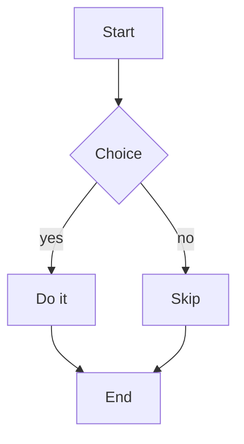

---

# Markdown showcase

Every element below exists to check colour: headings, **bold**, *italic*, ***bold italic***, ~~struck~~, `inline code`, [a link](https://example.com), and plain body text.

## Headings, all levels

### Third level

#### Fourth level

##### Fifth level

###### Sixth level

## Emphasis in context

A sentence with **bold words**, some *italic ones*, and **bold with `code` inside**. A second line with a [link in **bold**](https://example.com) and a footnote-style note<sup>1</sup>. Press <kbd>⌘</kbd> + <kbd>K</kbd> to search.

## Lists

- **Bold lead:** a plain bullet
- Another bullet with `code`
  - Nested bullet
  - Nested with **bold**
    - Third level
- Last bullet

1. First step
2. Second step with **emphasis**
   1. Sub-step one
   2. Sub-step two
3. Third step

- [x] Done task
- [ ] Open task
- [ ] Open task with **bold**

## Quotes and callouts

> A plain blockquote. It may run on for a couple of lines so the left rule and the muted ink are both visible, with **bold** and `code` inside.

> **Note:** a note-style quote.

> **Info:** an info-style quote.

> [!NOTE]
> A GitHub alert note with **bold** text.

> [!TIP]
> A tip, with a [link](https://example.com).

> [!IMPORTANT]
> Important content.

> [!WARNING]
> A warning.

> [!CAUTION]
> A caution.

::: details Folded block
Hidden body with **bold** and a list:

- one
- two
:::

## Tables

| Name | Type | Default | Notes |
|:-----|:----:|--------:|-------|
| `id` | **string** | `""` | required |
| `count` | number | `0` | counts *things* |
| `ready` | boolean | `false` | ~~old~~ new |
| `link` | url | — | [docs](https://example.com) |

## Code

Inline: `const a = 1`, `npm run build`, `--flag`.

```js
// a comment
import { mount } from 'md-editor';
const items = [1, 2, 3].map((n) => n * 2);
async function load(url = "/api") {
  const res = await fetch(url, { method: 'GET' });
  if (!res.ok) throw new Error(`HTTP ${res.status}`);
  return res.json();
}
```

```python
# a comment
@decorator
def greet(name: str = "world") -> str:
    return f"hello {name}" if name else None
```

```json
{ "name": "demo", "version": "1.0.0", "private": true, "tags": ["a", "b"], "n": 42 }
```

```bash
# install
npm install && npm run build   # then test
export KEY="value"
```

```diff
- removed line
+ added line
  context line
```

```css
.card > h1:hover { color: #135A31; margin: 0 auto; }
```

## Diagram



## Do and don't

#### Example

- ✅ Do it this way
- ❌ Not this way

## Questions

- **Q1: What does this page show?** **A** Every element a theme styles.
- **Q2: Why so many?** **A** So colours can be checked in one scroll.

---

Closing paragraph after a rule, with a final [link](https://example.com).
